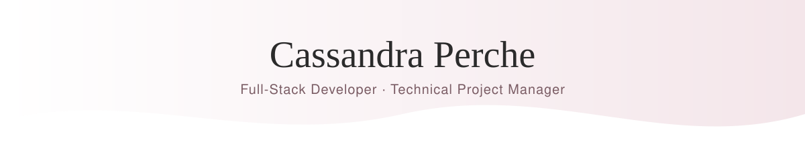

  <picture>
    <source media="(prefers-color-scheme: dark)" srcset="./banner-dark.svg" />
    
  </picture>

  

  
  
  

## About me

I'm Cassandra, a full-stack developer and technical project manager based in Buenos Aires, Argentina. I build web apps end to end with NestJS, React and PostgreSQL, and I'm just as comfortable meeting with stakeholders, writing specs and keeping a project on schedule. Claude Code is part of my daily workflow, and I review and test everything it produces.

- **Technical Project Manager & Full-Stack Developer** at PandoDev (remote startup, Utah), Aug–Nov 2026
- **Project Manager** at Alianza Idiomas (remote startup), 2022–2026
- Studying **B.S. Software Development** at **BYU-Idaho**
- Working toward **PMP** and **PMI-CPMAI**
- Native in **English** and **Spanish**

## Open to

Junior **full-stack** and **technical project management** roles, remote.

## Tech stack

<table>
  <tr>
    <th>Languages</th>
    <th>Frameworks</th>
    <th>Data</th>
    <th>DevOps & tools</th>
  </tr>
  <tr>
    <td align="center" valign="top"></td>
    <td align="center" valign="top"></td>
    <td align="center" valign="top"></td>
    <td align="center" valign="top"></td>
  </tr>
</table>

  
  
  
  
  

## Featured project

**Chore tracking app**: built on my own with NestJS, React and PostgreSQL, from planning to deployment, using Claude Code. This is the project that got me hired at PandoDev.

  

## GitHub activity

  <picture>
    <source media="(prefers-color-scheme: dark)" srcset="https://raw.githubusercontent.com/Sherrypeach/Sherrypeach/output/github-snake-dark.svg" />
    
  </picture>

