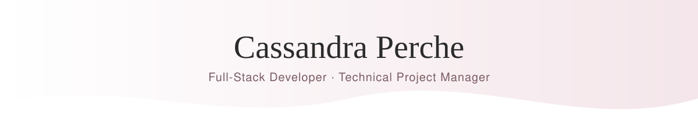

  <picture>
    <source media="(prefers-color-scheme: dark)" srcset="./banner-dark.svg" />
    
  </picture>

  

  
  
  

## Meet me

  
   
  <a href="https://youtu.be/2TucCSTVxi8">Watch in English</a> · <a href="https://youtu.be/E9XlOucYbzQ">Ver en español</a>

## About me

I'm Cassandra, a full-stack developer, project manager and customer service specialist based in Argentina. I build web and mobile apps end to end with React, React Native, NestJS and PostgreSQL, and I'm just as comfortable meeting with stakeholders, writing specs and keeping a project on schedule. Claude Code is part of my daily workflow, and I review and test everything it produces.

- **Technical Project Manager & Full-Stack Developer** at PandoDev (remote startup, Utah), Aug–Nov 2026
- **Freelance Web Developer** since 2022: websites, apps and online stores for clients from small businesses to large companies
- Published **React Native** apps to the **App Store** and **Google Play**
- **Project Manager** at Alianza Idiomas (remote startup), 2022–2026
- **Customer Service Representative** for a U.S. company
- Studying **B.S. Software Development** at **BYU-Idaho**, working toward **PMP** and **PMI-CPMAI**
- Fluent in **English**, native **Spanish**

> [!IMPORTANT]
> ### 🔒 Most of my client work is under NDA
> That's why most of it doesn't live on GitHub. I've built web apps, mobile apps and online stores for clients from small businesses to large companies.
>
> **Details and walkthroughs are available on request.** [Email me](mailto:casperche27@gmail.com)

## Open to

**Full-stack**, **mobile**, **project management** and **customer-facing** roles. Remote, full time or contract.

## Tech stack

<table>
  <tr>
    <th>Languages</th>
    <th>Frameworks</th>
    <th>Data</th>
    <th>DevOps & tools</th>
  </tr>
  <tr>
    <td align="center" valign="top"></td>
    <td align="center" valign="top"></td>
    <td align="center" valign="top"></td>
    <td align="center" valign="top"></td>
  </tr>
</table>

  
  
  
  
  
  
  

## Featured project

**Coming soon**: built on my own with NestJS, React and PostgreSQL, from planning to deployment, using Claude Code. This is the project that got me hired at PandoDev.

  

## GitHub activity

  <picture>
    <source media="(prefers-color-scheme: dark)" srcset="https://raw.githubusercontent.com/Sherrypeach/Sherrypeach/output/github-snake-dark.svg" />
    
  </picture>

